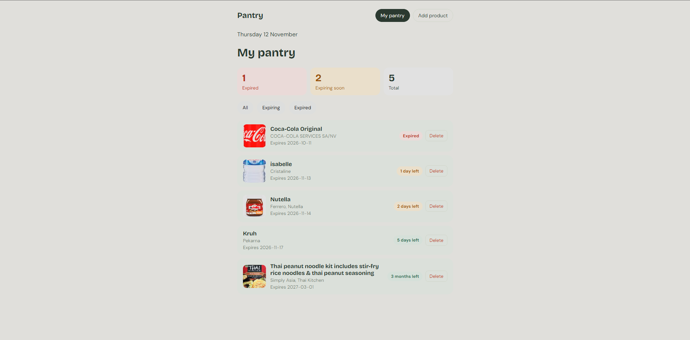
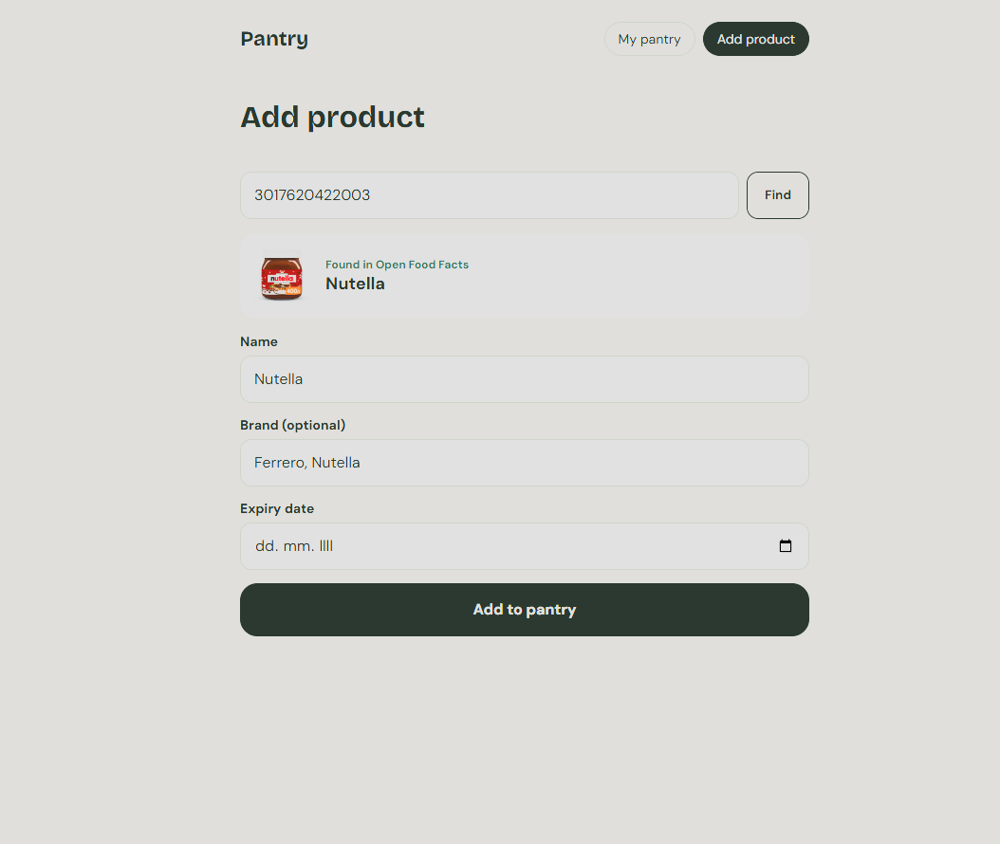
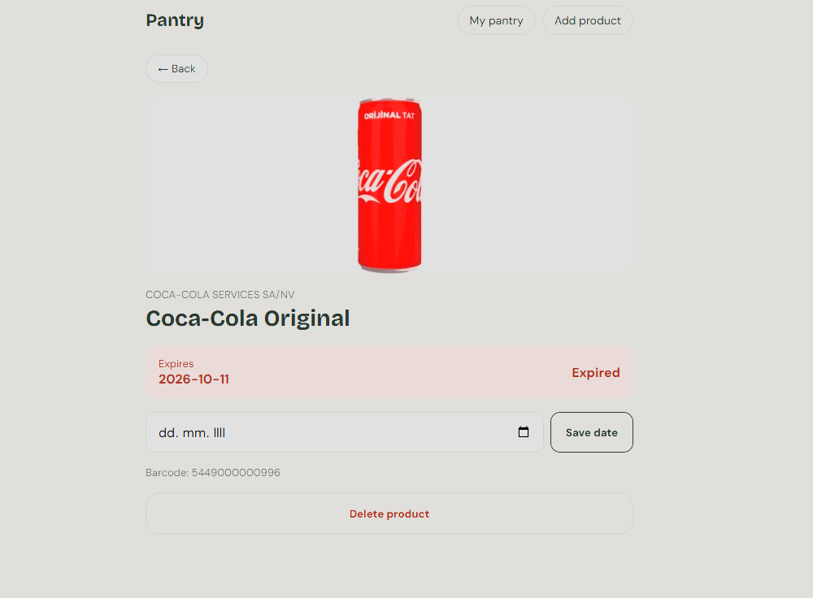

# Pantry Tracker

A mobile-first web app for tracking food expiry dates, so less food goes to waste.

**Live demo:** https://pantry-tracker-kyii.vercel.app



<p>
  
  
</p>

## Features

- **Barcode lookup**: find a product by its barcode through the Open Food Facts API; name, brand and image are filled in automatically
- **Expiry status**: colored badges for expired, expiring soon and fresh products, with days, months or years left
- **Filters in the URL**: All / Expiring / Expired, kept on refresh and shareable as a link
- **Sorting**: products sorted by expiry date, soonest first
- **Summary**: how many products are expired, expiring soon and in total
- **Product detail page**: change the expiry date or delete the product
- **Saved in the browser**: data persists in localStorage
- **Responsive**: works on phones from 320px up to desktop

## Built with

React · React Router · Context API + useReducer · custom hooks · CSS Modules · Vite · Open Food Facts API · Vercel

## How it is structured

```
src/
├── components/   # UI pieces: ProductCard, ProductList, FilterButtons, PantrySummary, Navbar
├── pages/        # routes: PantryPage, AddProductPage, ProductPage
├── context/      # PantryContext: reducer, split state/dispatch contexts, localStorage
├── hooks/        # useProduct: loading, error and result state for the barcode lookup
├── services/     # fetchProductsBarCode: talks to the Open Food Facts API
└── utils/        # expiry.js: days left and expiry status
```

## What I learned

- Splitting the barcode lookup into a **service** (API call), a **custom hook** (React state) and the **page** (UI), so each part has one job
- **Derived state**: filtering, sorting and the summary are calculated from the product list instead of being stored separately
- Using **URL search params** as state that several components can read
- Updating one item in a reducer with `map` and the spread operator
- Making the layout responsive and testing it at real phone widths

## Run locally

```bash
npm install
npm run dev
```
